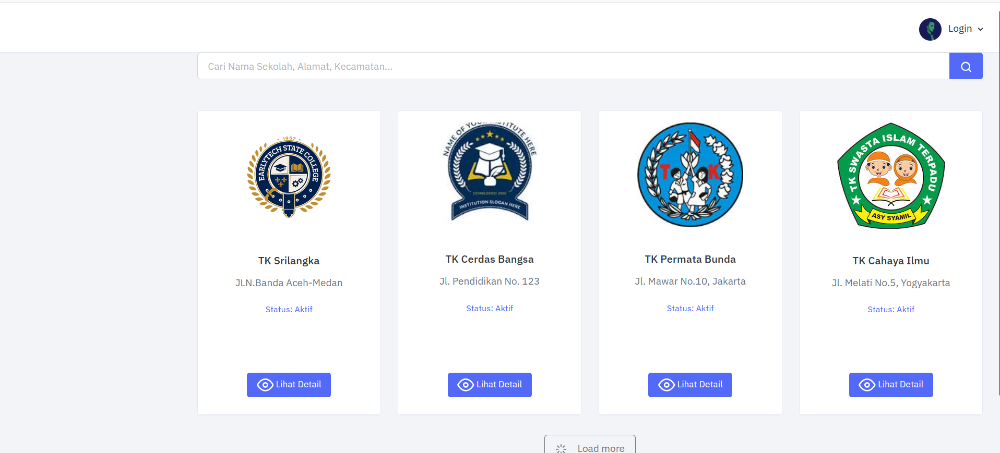
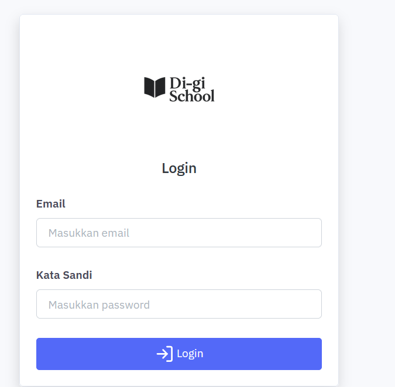
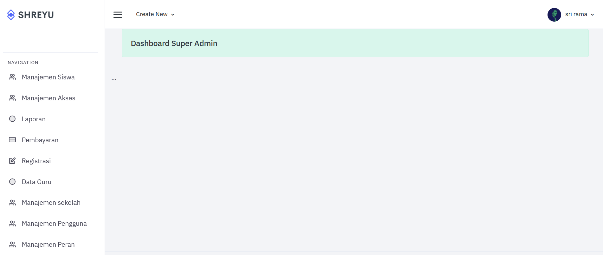
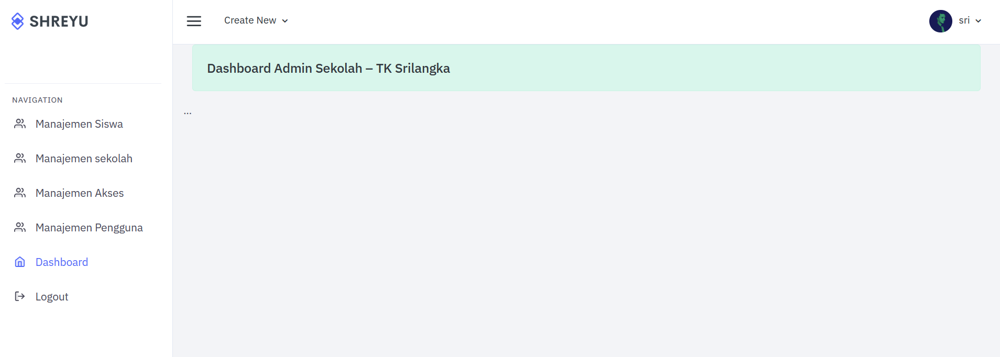
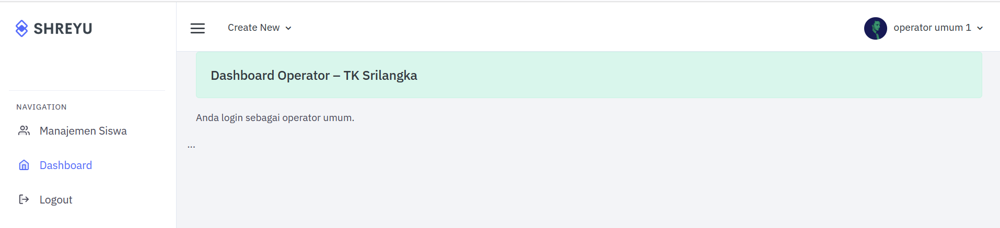
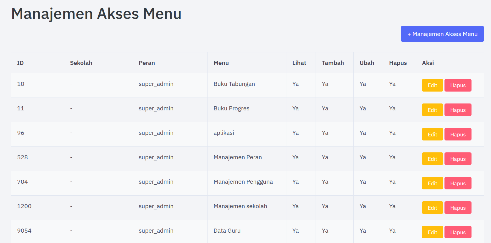

# rbac-sistem-informasi-tk
Sistem Informasi TK berbasis web dengan penerapan Role-Based Access Control (RBAC) untuk manajemen hak akses multiuser. PHP, CodeIgniter 3, MySQL
# Penerapan Role-Based Access Control (RBAC) pada Sistem Informasi TK Berbasis Multiuser

## 📌 Deskripsi Proyek
Sistem informasi sekolah Taman Kanak-Kanak (TK) berbasis web yang menerapkan 
metode Role-Based Access Control (RBAC) untuk mengelola hak akses multiuser 
sesuai peran pengguna. Dikembangkan sebagai proyek skripsi S1 Informatika, 
Universitas Almuslim, 2026.

## 🎯 Fitur Utama
- Login berdasarkan peran pengguna (role-based authentication)
- 3 level hak akses: Super Admin, Admin Sekolah, dan Operator
- Setiap peran memiliki menu dan akses yang berbeda-beda
- Manajemen akses menu yang dapat dikustomisasi per peran per sekolah
- Dashboard berbeda untuk setiap peran pengguna
- Mendukung multiuser dari beberapa sekolah TK sekaligus

## 👥 Peran Pengguna (RBAC)
| Peran | Hak Akses |
|-------|-----------|
| Super Admin | Akses penuh ke seluruh sistem dan semua sekolah |
| Admin Sekolah | Akses terbatas untuk sekolah yang dikelola |
| Operator | Akses sesuai izin yang diberikan Admin Sekolah |

## 🛠️ Tech Stack
- **Backend**: PHP, CodeIgniter 3
- **Frontend**: HTML, CSS, JavaScript
- **Database**: MySQL
- **Server**: XAMPP (localhost)

## 📸 Screenshot Sistem
### Portal Simulasi Multiuser

### Halaman Login

### Dashboard Super Admin

### Dashboard Admin Sekolah

### Dashboard Operator

### Manajemen Akses Menu

## 🚀 Cara Menjalankan
1. Clone repository ini
2. Import file database `.sql` ke MySQL
3. Konfigurasi database di `application/config/database.php`
4. Jalankan menggunakan XAMPP
5. Akses melalui browser: `http://localhost/nama-folder`

## 👤 Developer
**Sri Ramadhani**  
S1 Informatika — Universitas Almuslim  
IPK: 3,90 | Cumlaude | Wisudawan Terbaik 2026  
📧 sriramadani596@gmail.com
